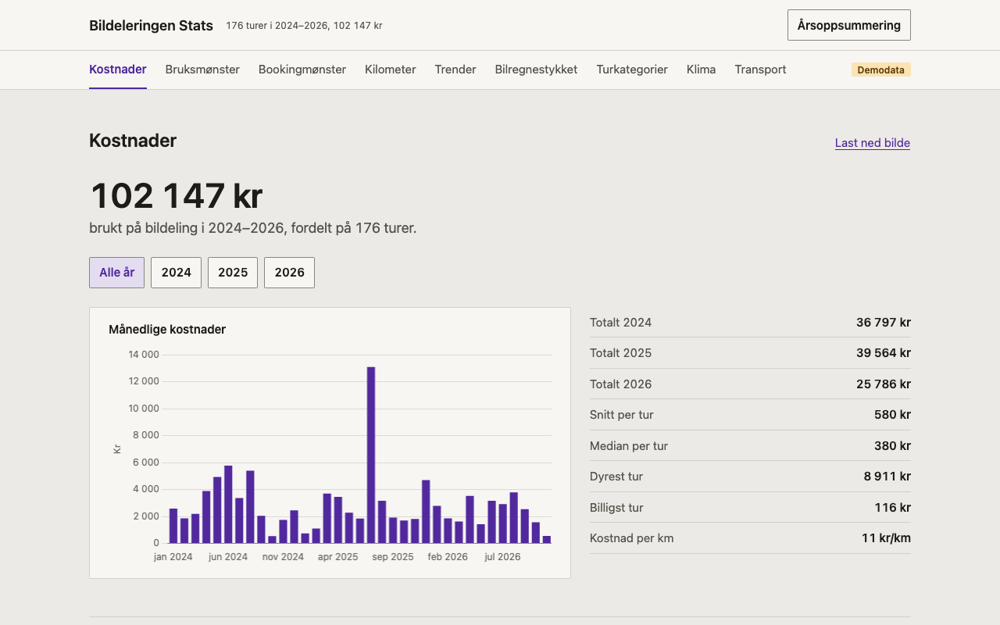
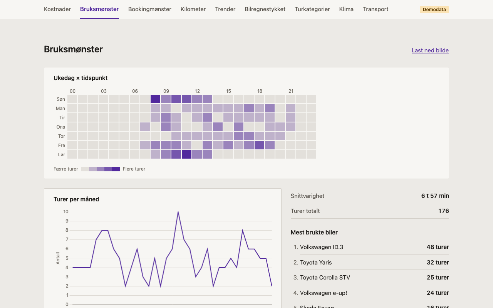
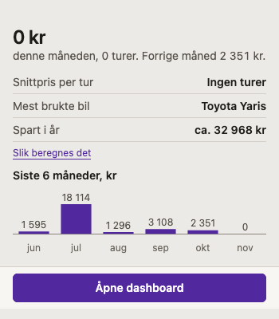
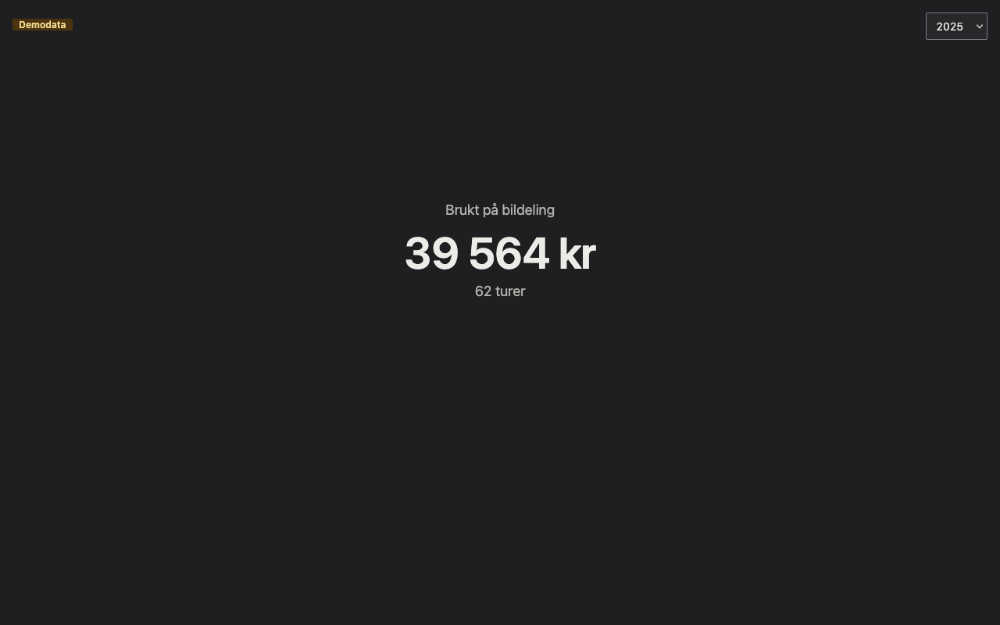
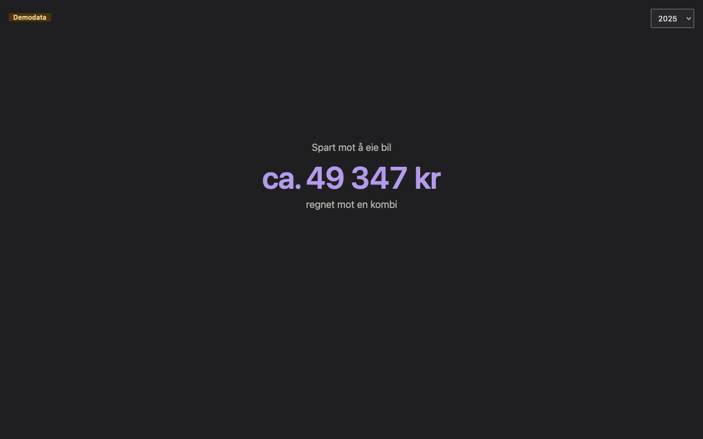

# Bildeleringen Stats

Nettleserutvidelse som viser hva Bildeleringen koster deg og hvordan du bruker det.

## Funksjoner

- **Popup**: månedsforbruk, snittpris, mest brukte bil og besparelse.
- **Dashboard** med grafer:
  - Kostnader (måned, år, per tur, per km)
  - Bruksmønster (heatmap, turer per måned, mest brukte biler)
  - Bookingmønster (forhåndsvarsel, mest brukte stasjoner, andel siste liten)
  - Kilometer (distanse, per bil, lengste tur)
  - Trender (år mot år, rullerende snitt, sesong)
  - Bilregnestykket (bildeling mot egen bil, også Volvo EX40)
  - Turkategorier (sortert automatisk etter turnotatene)
  - Klimaregnskap (CO₂ per drivstofftype og bil)
  - Transportkalkulator (taxi, leiebil, buss, fly, sykkel, totalbilde)
- **Årsoppsummering**: året ditt, én side per tall.
- **PNG-eksport** av hver seksjon.

## Slik ser det ut

<picture>
  <source media="(prefers-color-scheme: dark)" srcset="skjermbilder/dashboard-kostnader-mork.png">
  
</picture>

<picture>
  <source media="(prefers-color-scheme: dark)" srcset="skjermbilder/dashboard-bruksmonster-mork.png">
  
</picture>

<picture>
  <source media="(prefers-color-scheme: dark)" srcset="skjermbilder/popup-mork.png">
  
</picture>

## Installasjon

Last ned `.zip` fra [Releases](https://github.com/fredrik-lindseth/bildeleringen-stats/releases).

I Firefox:

1. Gå til `about:debugging#/runtime/this-firefox`
2. Klikk «Last inn midlertidig tillegg...»
3. Velg `.zip`-filen

I Chrome:

1. Pakk ut zip-filen
2. Gå til `chrome://extensions` og slå på Utviklermodus
3. Klikk «Last inn upakket» og velg mappen

Du må være innlogget på [app.dele.no](https://app.dele.no). Første synk tar noen minutter hvis du har mange turer. La dashboardet stå åpent til den er ferdig.

## Personvern

Alt lagres lokalt i nettleseren. Den eneste trafikken er API-kall til dele.no med innloggingen du alt har. Ingen tredjeparter, ingen sporing. Hvilke kall som gjøres og hvor ofte, står i [docs/api-bruk.md](docs/api-bruk.md).

## Estimater

Eierkostnader og CO₂ er estimater fra norske kilder (NAF, Miljødirektoratet, TØI). «Slik beregnes det» i dashboardet viser utregningen og kildene.

## Utvikling

Se [docs/DEVELOPMENT.md](docs/DEVELOPMENT.md).
